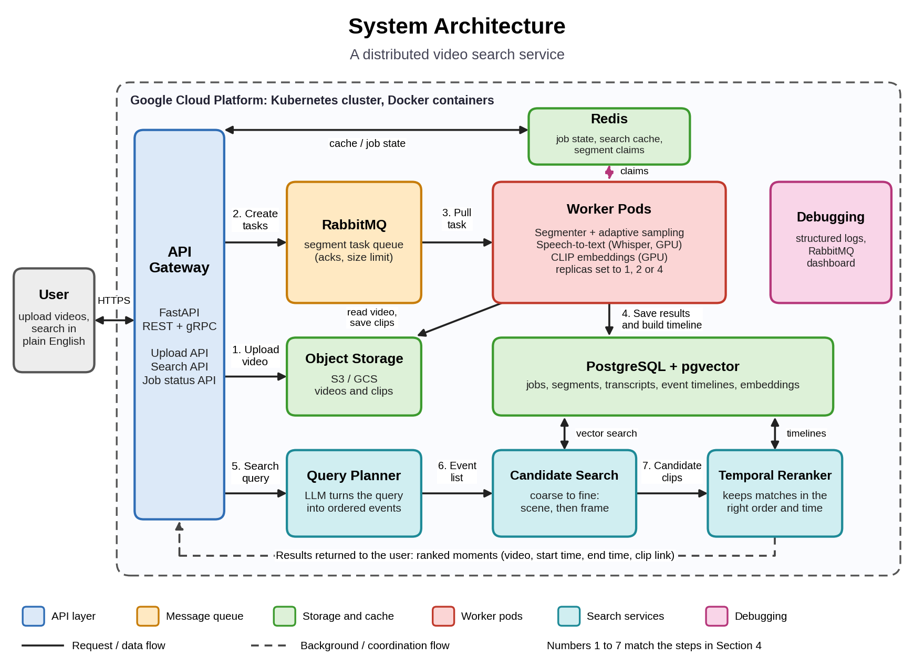

# A Distributed Video Search Service

**Team:** Tanay Raj, Aditya Gupta, Darshil Anish Shah

A service where users upload large video collections and search them in plain English, including queries that describe a *sequence* of events. Instead of returning a single matching frame, it returns the **video, start time and end time** of the matching moment.

> Example queries
> - Simple: `red car`
> - Compositional: `person gets out of a red car`
> - Temporal: `person gets out of a red car and then enters a building`

This README is the working spec for the build. It follows our project proposal. Anything marked **(proposed)** is a default we chose so we can start coding, and the team can change it as we learn more.

---

## Table of contents

1. [Goals](#1-goals)
2. [Architecture](#2-architecture)
3. [Tech stack](#3-tech-stack)
4. [How it works](#4-how-it-works)
5. [Interfaces and data (proposed)](#5-interfaces-and-data-proposed)
6. [Repository layout (proposed)](#6-repository-layout-proposed)
7. [Local development](#7-local-development)
8. [Debugging and testing](#8-debugging-and-testing)
9. [Evaluation plan](#9-evaluation-plan)
10. [Plan, work split and checklist](#10-plan-work-split-and-checklist)
11. [Stretch goals and risks](#11-stretch-goals-and-risks)
12. [Team conventions](#12-team-conventions)

---

## 1. Goals

1. **Smarter indexing.** Decide how closely to look at each part of a video with a simple, deterministic rule based on how much the picture changes. A static slide needs few samples, a car chase needs many. We measure how much compute and storage this saves versus fixed-rate sampling without hurting search accuracy.
2. **Searching for sequences.** An LLM breaks a query into ordered events. The system finds matches for each event and keeps only those that happen in the right order and close together in time. We compare this with ordinary frame-by-frame search.
3. **A pipeline that scales and recovers.** Videos are cut into segments processed in parallel by worker pods. We measure throughput with 1, 2 and 4 workers and show that killing a worker mid-job does not lose or duplicate work.

**Out of scope:** training new models (we use pretrained CLIP and Whisper), and anything in the [stretch goals](#11-stretch-goals-and-risks) list unless the core is finished.

---

## 2. Architecture



Uploads flow through the top half of the diagram, searches through the bottom half. Numbers 1 to 7 in the diagram match the steps in [How it works](#4-how-it-works).

Everything runs in Docker containers on a small Kubernetes cluster on Google Cloud: a CPU node for the API, queue, Redis and PostgreSQL, and one GPU node (T4 class) for the speech and vision models.

---

## 3. Tech stack

| Component | Technology | Purpose |
|---|---|---|
| API | FastAPI (REST), gRPC | Upload, search and job status for users; gRPC between services |
| Message encoding | Protocol Buffers, JSON | Typed task messages between services; JSON for the web API |
| Message queue | RabbitMQ | Holds video segments waiting for workers, redelivers after failures |
| Key-value store | Redis | Job progress, search cache, short-lived segment claims (locking) |
| Object storage | S3 or GCS (MinIO locally) | Raw videos and extracted clips |
| Workers | Python, ffmpeg, PySceneDetect | Segmenting, scene detection, frame selection |
| ML models | CLIP (open_clip), Whisper | Frame embeddings, speech-to-text |
| Database | PostgreSQL + pgvector | Jobs, transcripts, timelines, embeddings, similarity search |
| Query planner | LLM API with rule-based fallback | Turns a query into an ordered list of events |
| Containers | Docker, Kubernetes | Run everything; worker pod count is set by hand |

Course technology categories covered: message encoding, API interfaces, message queue, key-value store, distributed locking (Redis keys with expiry), database, containers, storage.

---

## 4. How it works

### 4.1 Indexing a video (steps 1 to 4)

1. **Upload.** The user uploads a video through the API. It is saved in object storage, the job is recorded in PostgreSQL, and the video is divided into short segments. Neighboring segments overlap by a few seconds so an event near a cut is not missed.
2. **Queue.** Each segment becomes a small task message in RabbitMQ. The message holds only a pointer to the segment, never the video itself. The queue has a size limit so a burst of uploads cannot overwhelm workers.
3. **Process.** A worker pulls a task and claims the segment with a short-lived Redis key so no other worker repeats it. If the worker crashes, the key expires. The worker then selects frames with the sampling rule below, computes CLIP embeddings for them, and transcribes the speech with Whisper.
4. **Save and combine.** The worker saves embeddings, transcript and timestamps in PostgreSQL and marks the segment done. When the last segment of a video finishes, a query lines up speech and visual results by timestamp into one timeline for the video, joining pieces split across segment boundaries.

### 4.2 Frame selection rule (adaptive indexing)

The rule is fixed and deterministic: the same video and settings always give the same frames. Nothing is learned.

```text
decode segment at low resolution (grayscale, downscaled)
last_kept = first frame; accumulated = 0
for each frame f:
    accumulated += diff(f, previous_frame)        # mean pixel difference or histogram distance
    gap = time(f) - time(last_kept)
    if gap < MIN_GAP:                  continue    # caps busy scenes (start: 0.25 s)
    if scene_cut(f) or accumulated >= THRESHOLD or gap >= MAX_GAP:   # MAX_GAP start: 20 s
        keep(f); last_kept = f; accumulated = 0
```

- A static slide never reaches the threshold, so it yields about one frame every `MAX_GAP`.
- A fast action scene hits the cap of one frame per `MIN_GAP`.
- Slow drift (a person walking across a room) still triggers because change accumulates.
- Whisper transcribes all the audio, so speech coverage is not reduced. Savings apply to the vision side.
- Known weak spot: shaky or noisy video can over-sample. `MIN_GAP` bounds the cost.

`THRESHOLD`, `MIN_GAP` and `MAX_GAP` are the only tuned settings. We tune them on a validation set.

### 4.3 Searching (steps 5 to 7)

5. **Plan.** The Search API checks Redis for a cached answer. If there is none, an LLM turns the query into an ordered list of events and decides what matters most (for example `where does he say deadlock` leans on the transcript, `red sports car` leans on visuals).
6. **Retrieve.** For each event, search coarse to fine: top scenes first, then frames inside the best scenes. This looks at a few hundred frames instead of every frame in the library.
7. **Rerank.** Load timelines for the candidate videos and keep only sequences where the events happen in the right order and close together. Return the best match as video, start time, end time and clip link.

### 4.4 When something goes wrong

- If a worker dies, its Redis claim expires and RabbitMQ redelivers the unacknowledged task to another worker.
- The new worker checks the segment's status in PostgreSQL and skips it if already `DONE`.
- Writes are idempotent (upsert on `video_id, segment_id`), so a repeated run overwrites instead of duplicating.
- The queue has a size limit and each worker prefetches only a few tasks, so overload shows up as queue length instead of memory blowups.

---

## 5. Interfaces and data (proposed)

### 5.1 REST API

| Method | Path | Description |
|---|---|---|
| `POST` | `/videos` | Upload a video, returns `video_id` |
| `GET` | `/videos/{video_id}/status` | Segments total, done, failed |
| `POST` | `/search` | Body: `{"query": "...", "top_k": 5}`, returns ranked moments |
| `GET` | `/health` | Liveness check |

Search response item:

```json
{ "video_id": "v42", "start_sec": 10.1, "end_sec": 38.0, "score": 0.83, "clip_url": "..." }
```

### 5.2 Task message (Protocol Buffers)

```proto
message SegmentTask {
  string video_id       = 1;
  int32  segment_id     = 2;
  double start_sec      = 3;
  double end_sec        = 4;
  string video_uri      = 5;   // pointer into object storage
  int32  attempt        = 6;
  string config_version = 7;   // sampling settings + model versions
}
```

### 5.3 Query planner output

```json
{
  "events": [
    { "id": 1, "description": "person exits red car", "weights": { "visual": 0.8, "speech": 0.2 } },
    { "id": 2, "description": "person enters building", "weights": { "visual": 0.9, "speech": 0.1 } }
  ],
  "relations": [ { "before": 1, "after": 2, "max_gap_sec": 60 } ]
}
```

If the LLM call fails or returns invalid JSON, the fallback treats the query as one event.

### 5.4 PostgreSQL tables

```sql
videos      (video_id PK, uri, duration_sec, status, created_at)
segments    (video_id, segment_id, start_sec, end_sec, status, attempt, worker_id, updated_at,
             PRIMARY KEY (video_id, segment_id))        -- status: PENDING | PROCESSING | DONE | FAILED
scenes      (video_id, scene_id, start_sec, end_sec, embedding vector(512))   -- mean of frame embeddings
frames      (video_id, segment_id, ts_sec, scene_id, embedding vector(512),
             PRIMARY KEY (video_id, segment_id, ts_sec))
transcripts (video_id, segment_id, start_sec, end_sec, text, tsv tsvector)
timeline    (video_id, start_sec, end_sec, kind, text)  -- merged speech + visual intervals
```

Embedding size depends on the CLIP variant (512 shown for ViT-B/32). Add an HNSW or IVFFlat index on `frames.embedding` and `scenes.embedding`, and a GIN index on `transcripts.tsv` so speech matches can use PostgreSQL full-text search.

### 5.5 Redis keys

| Key | Type | Use |
|---|---|---|
| `claim:{video_id}:{segment_id}` | string, `SET NX EX 60`, value = worker id | One worker per segment; renewed while working |
| `job:{video_id}:progress` | hash (`total`, `done`, `failed`) | Fast status reads |
| `cache:search:{hash(query)}` | string (JSON), short TTL | Cached search results |

### 5.6 RabbitMQ settings

- Durable queue `segment_tasks` with a maximum length and `reject-publish` overflow so producers are slowed down when full.
- Manual acknowledgements, sent only after results are saved. Prefetch count of 1 to 2 per worker.
- Dead-letter queue `segment_tasks_dlq` after a set number of attempts, so one bad segment cannot loop forever.

### 5.7 Reranking logic

For each video, take the top-N candidate times per event and find the sequence `t1 < t2 < ... < tn` that satisfies every `before/after` relation within `max_gap_sec` and maximizes:

```text
sum(event_score_i) - lambda * sum(gap_i)
```

Each event score combines the modalities with the planner's weights: `w_visual * CLIP similarity + w_speech * full-text rank`. Return `[t1 - pad, tn + pad]` as the moment.

---

## 6. Repository layout (proposed)

```text
.
├── README.md
├── docker-compose.yml        # full local stack
├── docs/                     # architecture.png, proposal
├── proto/                    # .proto files (SegmentTask, planner, search)
├── services/
│   ├── api/                  # FastAPI gateway: upload, search, job status
│   ├── worker/               # segmenter, frame selection, CLIP, Whisper
│   ├── planner/              # query planner (LLM + fallback)
│   └── search/               # candidate search + temporal reranker
├── db/                       # schema.sql, migrations
├── k8s/                      # Kubernetes manifests
├── eval/                     # datasets, labeled queries, metric scripts
└── scripts/                  # experiment runners, fault injection
```

---

## 7. Local development

The whole stack should run on a laptop with `docker-compose` (RabbitMQ, Redis, PostgreSQL with pgvector, MinIO, one worker) using 1 to 2 minute test videos. Use this before spending any cloud time.

Planned commands (to be filled in as Phase 1 lands):

```bash
docker compose up --build          # start the stack
python scripts/upload_sample.py    # upload a short test video
python scripts/search.py "red car" # run a query
```

Configuration (broker URL, database URL, bucket, sampling settings, model names) comes from environment variables, with a `.env.example` committed to the repo. Never commit keys.

---

## 8. Debugging and testing

- **Build locally first.** Reproduce bugs on a laptop before touching the cluster.
- **Traceable logs.** Every log line includes `video_id`, `segment_id` and `worker_id`, so one segment can be followed from upload to index.
- **Queue visibility.** The RabbitMQ management page shows queue length and unacknowledged messages. We also log processing time per segment. A stuck stage shows up as a growing queue.
- **Re-running failed work.** Segment status lives in PostgreSQL, so stuck or failed segments can be put back on the queue. We delete worker pods on purpose to test recovery.
- **Tests.**
  - Unit tests for the frame selection rule and the ordering logic, using small hand-made timelines.
  - An end-to-end test that uploads a short video and checks that a known query returns the right time range.

---

## 9. Evaluation plan

We use pretrained models, so there is no model training. We tune three settings (`THRESHOLD`, `MIN_GAP`, `MAX_GAP`) on a validation set and report on a separate test set.

**Data:** about 10 hours of video, a mix of lecture recordings and short everyday-activity clips (for example a subset of a public dataset such as Charades-STA). We write and label 30 to 40 queries with correct start and end times, in three levels: simple, compositional and temporal.

Suggested query file (`eval/queries.jsonl`), one per line:

```json
{"id": "q07", "level": "temporal", "query": "person gets out of a red car and then enters a building", "video_id": "v42", "start_sec": 16.0, "end_sec": 38.0}
```

| Experiment | What we change | What we measure |
|---|---|---|
| **A. Scaling** | 1, 2 and 4 worker pods | Hours of video indexed per hour, GPU use, queue length over time |
| **B. Adaptive indexing** | Fixed 1 FPS, uniform sampling with the same number of frames, adaptive sampling at several thresholds | Number of embeddings, GPU time, storage, Recall@K, plotted as accuracy against cost |
| **C. Temporal search** | Plain frame search versus ordered-event search | Recall@K and overlap with the true time range, for all three query levels |
| **D. Failure recovery** | Kill one worker during indexing | Recovery time, segments redone, whether the final index matches a run with no failure |

The key comparison in B is against uniform sampling at the **same frame budget**. Beating fixed 1 FPS alone is not enough.

---

## 10. Plan, work split and checklist

### Work split

| Stream | Scope | Owner |
|---|---|---|
| 1. Infrastructure | API, storage, queue, Redis, Kubernetes | TBD |
| 2. Workers and indexing | Segmenting, frame selection, CLIP, Whisper | TBD |
| 3. Timelines and search | Timeline building, query planner, reranker | TBD |

All three of us share the experiments and the final report.

### Phases

- [ ] **Phase 1: Baseline.** Upload API, storage, queue, one worker type, CLIP embeddings in PostgreSQL, basic search with fixed-rate sampling, all running locally.
- [ ] **Phase 2: Adaptive indexing and speech.** Whisper transcripts, the frame selection rule, timelines built from vision and speech.
- [ ] **Phase 3: Sequences and deployment.** Query planner and temporal reranker; move to Kubernetes with Redis claims.
- [ ] **Phase 4: Experiments.** Run experiments A to D, scripted so they can run unattended, and fix problems they reveal.
- [ ] **Phase 5: Wrap-up.** Final report, demo and presentation.

### Definition of done for the core system

- [ ] A video can be uploaded and indexed end to end.
- [ ] A plain-English query returns a video and a time range.
- [ ] A two-event ordered query works and beats frame-only search on our labeled queries.
- [ ] Killing a worker mid-index results in a correct final index.
- [ ] Experiments A to D have results and plots.

---

## 11. Stretch goals and risks

**Stretch goals** (only if the core is finished early): OCR for on-screen text, short action captions from a small vision-language model, Spark for building timelines, a dedicated vector database such as Milvus, automatic worker scaling with KEDA, and recommending related moments from a viewing history.

**Risks and fallbacks**

| Risk | Plan |
|---|---|
| GPU access and cost | Develop on small videos locally, save larger runs for scaling experiments, fall back to a reduced CPU version and say so |
| Search quality from simple models | Report results honestly even if gains are modest |
| Falling behind schedule | Cut in this order: the 4-worker run (keep 1 and 2), the third query level, the second sampling baseline in experiment B |

---

## 12. Team conventions

- Work on feature branches and open a pull request into `main`. At least one teammate reviews before merging.
- Keep services idempotent: running the same task twice must be harmless.
- Log with the shared fields (`video_id`, `segment_id`, `worker_id`) everywhere.
- Pin model versions and sampling settings in `config_version` so results are reproducible.
- Update this README when a **(proposed)** detail changes.
